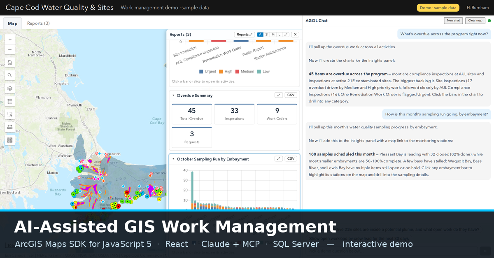

# Cape Cod Water Quality & Sites: AI-assisted work management demo

**Live demo:** https://thegreylady.github.io/cape-cod-work-demo/

A portfolio demo of a GIS work-management app built on the **ArcGIS Maps SDK for JavaScript 5** (React + TypeScript). It shows a fictional Cape Cod water-quality and contaminated-sites program: monitoring stations sampled each month, active MassDEP Chapter 21E cleanup sites, and sites with Activity & Use Limitations (AULs).

**What you can try**
- Map tools: search, layer list with legends, basemaps, measure, and a select tool (click, box or lasso) that pulls up the work on the selected features.
- An AI assistant panel. In this public copy it **replays a recorded session** of the live app (pick the suggested questions in order). Each answer builds real charts, tables and timelines and updates the map.
- Interactive reports: hover for details, click a bar or slice to drill into exactly those work orders, resize cards on the Reports board.
- Work-order records you can open and edit, with a preview-and-confirm step. Edits stay in your browser and reset on reload.

**About the data**
- Map layers are public data from the Cape Cod Commission and MassDEP.
- People, inspections, work orders and costs are **generated sample data**, a snapshot as of 2026-10-10.

**How the live version works** (not included in this static copy)
- A Node.js bridge runs the Claude tool-use loop.
- It connects to two Model Context Protocol (MCP) servers: one for ArcGIS Online/Portal data, one for a SQL Server work-order database.
- The database enforces its business rules in stored procedures, and changes are previewed before they're confirmed.

This repository holds only the built static site.
